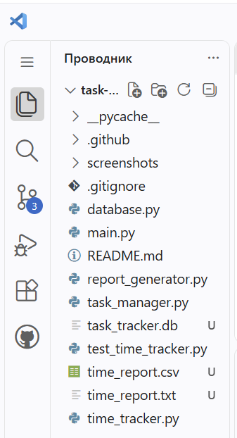
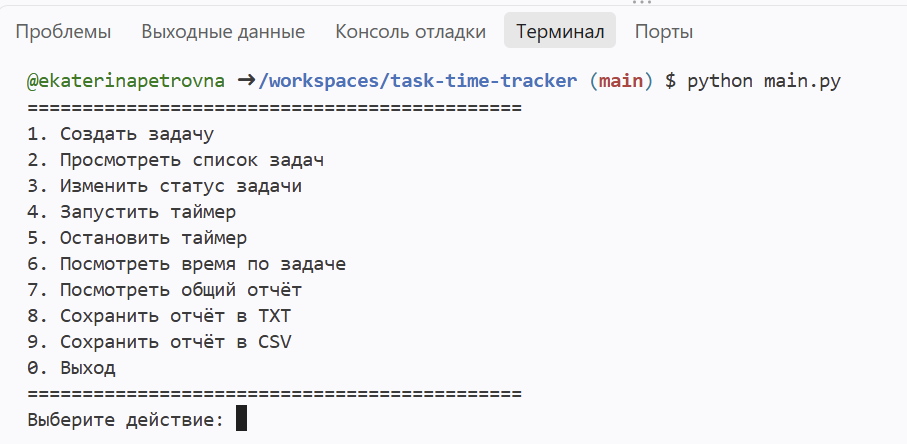
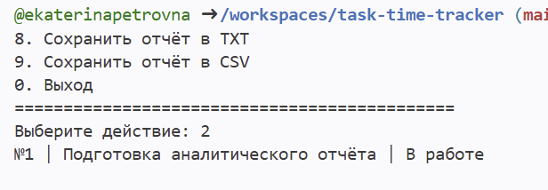
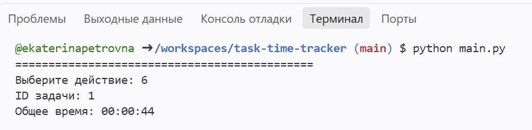
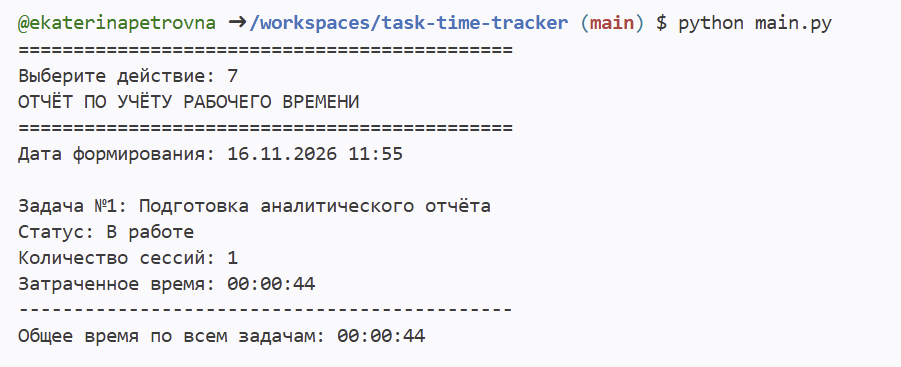
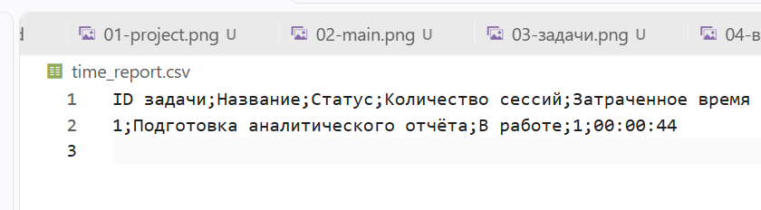
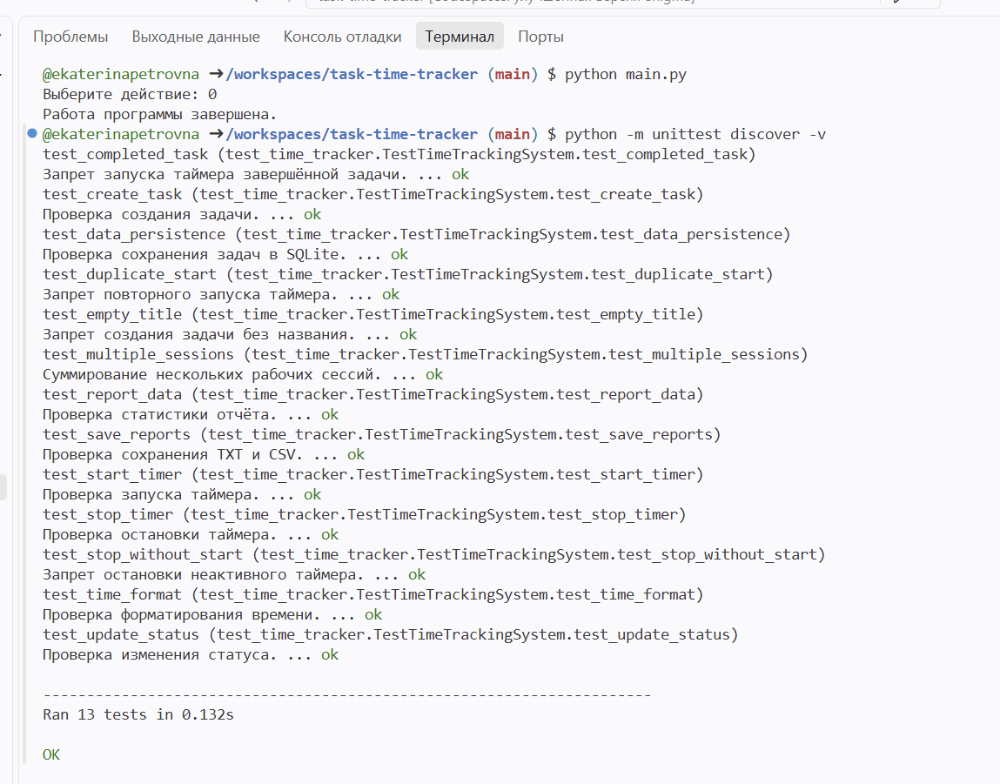

# Модуль учёта рабочего времени для системы управления задачами

Практическое задание к лекции №5 «Этапы разработки программного продукта».

**Дисциплина:** Проектирование и разработка бизнес-ориентированного программного обеспечения.

## Описание проекта

Проект представляет собой программный модуль учёта рабочего времени, разработанный на языке Python.

Система предназначена для управления задачами, отслеживания времени их выполнения, хранения информации в базе данных SQLite и формирования отчётов.

Приложение работает через консольное меню и позволяет пользователю создавать задачи, изменять их статусы, запускать и останавливать таймер, просматривать статистику и сохранять отчёты.

## Назначение

Основная цель разработки — автоматизация учёта времени, затрачиваемого на выполнение рабочих задач.

Система обеспечивает:

- Создание и хранение задач.
- Просмотр списка существующих задач.
- Изменение статуса задачи.
- Запуск и остановку таймера.
- Подсчёт времени выполнения каждой задачи.
- Суммирование нескольких рабочих сессий.
- Формирование общего отчёта.
- Экспорт отчётов в форматы TXT и CSV.
- Сохранение данных в SQLite.

## Используемые технологии

- **Python 3.12** — язык программирования.
- **SQLite** — хранение задач и рабочих сессий.
- **unittest** — автоматизированное модульное тестирование.
- **Git** — контроль версий.
- **GitHub** — хранение исходного кода.
- **GitHub Actions** — автоматический запуск тестов.
- **GitHub Codespaces** — среда разработки и выполнения программы.

## Структура проекта

| Файл | Назначение |
|---|---|
| `main.py` | Главная программа и консольное меню |
| `database.py` | Работа с базой данных SQLite |
| `task_manager.py` | Создание задач и управление статусами |
| `time_tracker.py` | Запуск, остановка таймера и учёт времени |
| `report_generator.py` | Формирование отчётов TXT и CSV |
| `test_time_tracker.py` | Модульные тесты |
| `README.md` | Документация проекта |
| `.gitignore` | Исключение служебных файлов из Git |
| `.github/workflows/tests.yml` | Автоматическое тестирование |

## Функциональные требования и реализация

| № | Требование | Реализация |
|---|---|---|
| 1 | Создание задач | `task_manager.py` |
| 2 | Просмотр списка задач | `task_manager.py` |
| 3 | Изменение статуса | `task_manager.py` |
| 4 | Запуск и остановка таймера | `time_tracker.py` |
| 5 | Подсчёт затраченного времени | `time_tracker.py` |
| 6 | Хранение информации | `database.py` |
| 7 | Формирование статистики | `report_generator.py` |
| 8 | Сохранение отчёта TXT | `report_generator.py` |
| 9 | Сохранение отчёта CSV | `report_generator.py` |
| 10 | Автоматизированное тестирование | `test_time_tracker.py` |

## Основные компоненты системы

### Database

Компонент обеспечивает взаимодействие с базой данных SQLite, хранение информации о задачах и рабочих сессиях.

### TaskManager

Компонент отвечает за создание задач, получение их списка и изменение статусов.

### TimeTracker

Компонент реализует механизм учёта рабочего времени. Позволяет запускать и останавливать таймер, контролировать активные сессии и рассчитывать продолжительность работы.

### ReportGenerator

Компонент предназначен для формирования статистики по выполненным задачам и сохранения отчётов в текстовом формате и CSV.

## Инструкция по запуску

Для запуска проекта необходимо открыть терминал в GitHub Codespaces или другой среде с установленным Python.

Выполнить команду:

```bash
python main.py
```

После запуска появится консольное меню:

```text
СИСТЕМА УЧЁТА РАБОЧЕГО ВРЕМЕНИ

1. Создать задачу
2. Просмотреть список задач
3. Изменить статус задачи
4. Запустить таймер
5. Остановить таймер
6. Посмотреть время по задаче
7. Посмотреть общий отчёт
8. Сохранить отчёт в TXT
9. Сохранить отчёт в CSV
0. Выход
```

## Пример работы программы

В ходе проверки была создана задача:

**Название:** Подготовка аналитического отчёта.

**Описание:** Сбор и анализ данных, подготовка итогового отчёта по проекту.

После создания задачи система присвоила ей идентификатор №1.

Был запущен и остановлен таймер, после чего сформирован отчёт.

Результаты:

| Показатель | Значение |
|---|---|
| ID задачи | 1 |
| Название | Подготовка аналитического отчёта |
| Статус | В работе |
| Количество рабочих сессий | 1 |
| Затраченное время | 00:00:44 |
| Общее время | 00:00:44 |

Отчёт был успешно сохранён в форматах TXT и CSV.

## Модульное тестирование

Для проверки корректности работы программы разработаны автоматизированные модульные тесты с использованием библиотеки `unittest`.

Запуск тестирования:

```bash
python -m unittest discover -v
```

Проверяются следующие функции:

1. Создание задачи.
2. Запрет создания задачи без названия.
3. Изменение статуса задачи.
4. Запуск таймера.
5. Остановка таймера.
6. Запрет повторного запуска активного таймера.
7. Запрет остановки неактивного таймера.
8. Суммирование нескольких рабочих сессий.
9. Сохранение информации в SQLite.
10. Формирование статистики отчёта.
11. Сохранение отчётов TXT и CSV.
12. Форматирование времени.
13. Работа с завершённой задачей.

**Результат тестирования: 13 тестов успешно пройдены.**

```text
Ran 13 tests in 0.083s

OK
```

## Автоматизация тестирования с GitHub Actions

В проекте настроен рабочий процесс GitHub Actions.

Файл конфигурации:

`.github/workflows/tests.yml`

Автоматическое тестирование запускается при:

- Отправке изменений в репозиторий (`push`).
- Создании или обновлении Pull Request.
- Ручном запуске рабочего процесса.

Тестирование выполняется на Ubuntu с использованием Python 3.12.

**Результат:** рабочий процесс GitHub Actions успешно завершён, все 13 тестов пройдены.

## Контроль версий Git

Для управления исходным кодом используется Git.

Проект размещён в публичном репозитории GitHub.

В процессе разработки создавались отдельные коммиты для реализации базы данных, управления задачами, учёта времени, формирования отчётов, тестирования и настройки GitHub Actions.

Основная ветка проекта — `main`.

## Результаты разработки

В ходе выполнения практического задания:

- Разработана система управления задачами и учёта времени.
- Реализовано хранение данных в SQLite.
- Добавлены функции запуска и остановки таймера.
- Реализован подсчёт затраченного времени.
- Добавлено формирование отчётов TXT и CSV.
- Разработаны и успешно выполнены 13 модульных тестов.
- Настроено автоматическое тестирование GitHub Actions.
- Исходный код размещён в GitHub.

## Заключение

В результате выполнения практического задания разработан работоспособный модуль учёта рабочего времени для системы управления задачами.

Реализованные функции позволяют отслеживать выполнение задач, фиксировать продолжительность рабочих сессий и формировать отчёты.

Использование модульного тестирования и GitHub Actions обеспечивает автоматизированную проверку корректности работы программного продукта.

## Результаты выполнения

В данном разделе представлены скриншоты, демонстрирующие
структуру проекта, работу основных функций программы,
формирование отчётов и результаты тестирования.

### 1. Структура проекта

На рисунке 1 представлена структура проекта в среде
GitHub Codespaces. Программа разделена на отдельные модули
для управления задачами, учёта времени, хранения данных
и формирования отчётов.



**Рисунок 1 — Структура проекта в GitHub Codespaces**

### 2. Запуск программы

На рисунке 2 показан запуск программы командой
`python main.py`. После запуска пользователю предоставляется
консольное меню для выбора необходимых действий.



**Рисунок 2 — Главное меню системы учёта рабочего времени**

### 3. Просмотр списка задач

На рисунке 3 представлен список зарегистрированных задач.
Для каждой задачи отображаются уникальный идентификатор,
название и текущий статус.



**Рисунок 3 — Просмотр списка задач**

### 4. Учёт рабочего времени

На рисунке 4 показан результат подсчёта времени,
затраченного на выполнение выбранной задачи.
Продолжительность отображается в формате часы:минуты:секунды.



**Рисунок 4 — Просмотр затраченного времени по задаче**

### 5. Формирование общего отчёта

На рисунке 5 представлен общий отчёт по учёту рабочего
времени. Он содержит сведения о задачах, их статусах,
количестве рабочих сессий и общей продолжительности работы.


**Рисунок 5 — Формирование общего отчёта по рабочему времени**

### 6. Сохранение отчёта в формате TXT

На рисунке 6 представлен сформированный текстовый отчёт.
Файл содержит информацию о выполнении задачи и суммарном
затраченном времени.



**Рисунок 6 — Содержимое отчёта в формате TXT**

### 7. Сохранение отчёта в формате CSV

На рисунке 7 представлен отчёт в формате CSV.
Данный формат позволяет использовать полученные результаты
для дальнейшего анализа в электронных таблицах.



**Рисунок 7 — Содержимое отчёта в формате CSV**

### 8. Автоматическое тестирование

На рисунке 8 представлены результаты модульного
тестирования программы с использованием библиотеки unittest.

В ходе тестирования проверялись создание задач,
изменение статусов, запуск и остановка таймера,
суммирование рабочих сессий, сохранение данных
и формирование отчётов.



**Рисунок 8 — Результаты выполнения модульных тестов**

Результат тестирования:

- Выполнено тестов: 13.
- Успешно пройдено: 13.
- Ошибок: 0.
- Время выполнения: 0.132 секунды.
- Итоговый статус: OK.

### Вывод по результатам выполнения

В результате практической проверки подтверждена
работоспособность основных функций разработанной системы.

Программа обеспечивает создание и хранение задач,
учёт затраченного рабочего времени, формирование
статистики и экспорт отчётов в форматы TXT и CSV.

Все 13 автоматизированных модульных тестов успешно
пройдены. Это подтверждает корректность проверенных
функций программного продукта.
